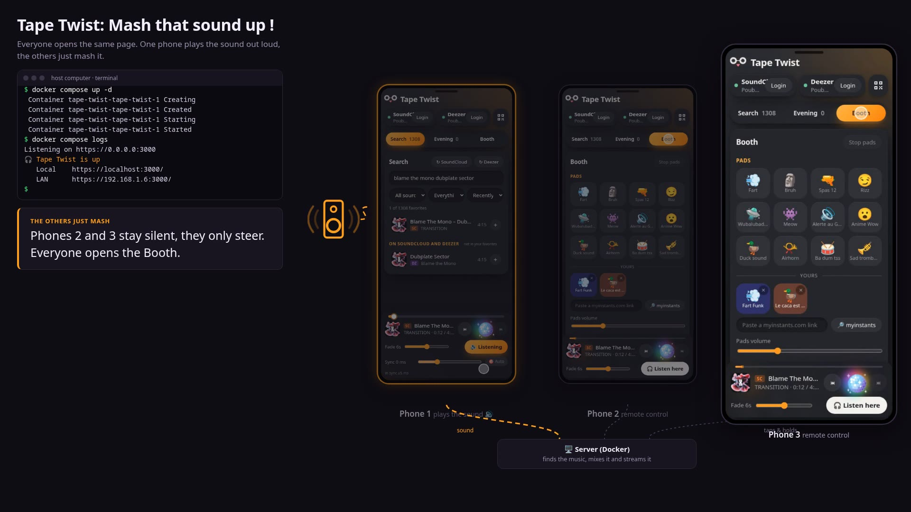

<p align="center">
  
</p>

<h1 align="center">Tape Twist</h1>
<h3 align="center">Mash that sound up!</h3>

<p align="center">
  <video src="docs/demo.mp4" poster="docs/demo.jpg" controls muted width="100%">
    <a href="docs/demo.mp4"></a>
  </video>
</p>

<p align="center"><b>Everyone's a DJ now!</b> Your SoundCloud and Deezer favorites, mixed live on one server and played in sync by every phone in the room.</p>

- 🔗 **Connect your accounts** and play your SoundCloud and Deezer likes (plus both catalogs) on as many devices as you want, all in sync.
- 🎛️ **Mess around with your friends:** pads, talkover with funny voices, brake, rewind, stutter, an XY filter, colours and a light show, from any phone.
- 📼 **Plan the evening:** playlists with start times, crossfades and bass swaps.
- 🤖 **Ask Claude** for songs ("calm bass music around this track") and they land in the playlist.

## Quick start

You only need **Docker**.

```sh
git clone https://github.com/zeuros/tape-twist.git && cd tape-twist
./scripts/serve.sh
```

Open the printed link on a phone (same Wi-Fi, accept the certificate warning), enter the PIN (`1234` by default), connect SoundCloud and Deezer, press play, then tap **Listen here** on the phone next to the speaker. Your logins stay in `./data` (git-ignored): keep it private.

More in the **[guide](docs/guide.md)** (Tailscale Funnel, Android app, commands) and **[how it works](docs/internals.md)**.
